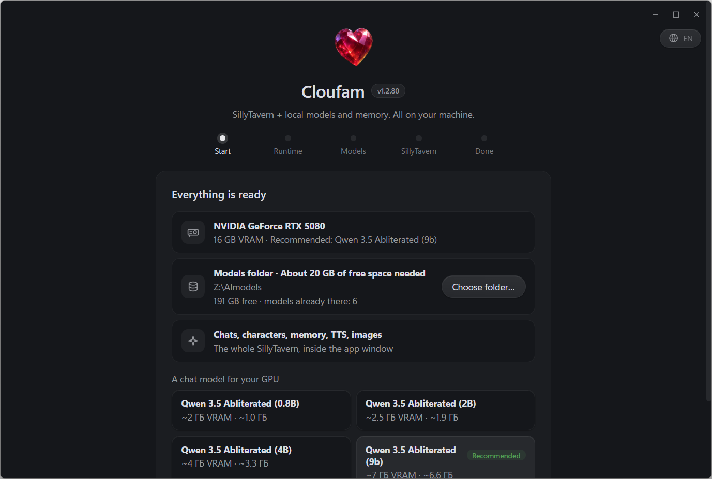
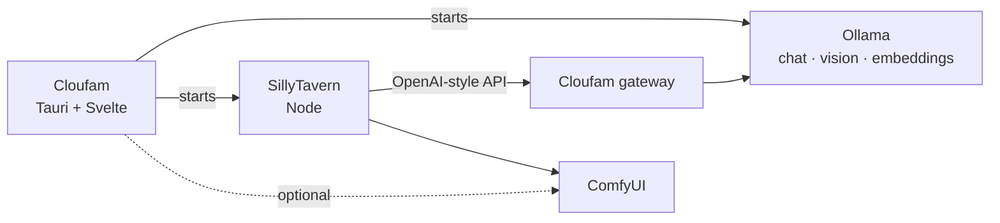

<div align="center">


# Cloufam

**A local roleplay studio: SillyTavern, Ollama and ComfyUI — installed, tuned for your GPU and running in one window.**

[](https://tauri.app/)
[](https://svelte.dev/)
[](https://www.rust-lang.org/)
[](#requirements)
[](LICENSE)

[Download](https://github.com/AndreyFSDev/cloufam-releases/releases/latest) · [Guide](docs/guide.md) · [Features](#features) · [Build from source](#build-from-source) · [License](#license)

</div>

## Why Cloufam

**The one thing others don't do:** Cloufam is not another chat UI and not a Docker recipe. It is a single portable `Cloufam.exe` that installs SillyTavern, Ollama and ComfyUI itself, picks models that fit *your* GPU and VRAM, and puts its own gateway between SillyTavern and the model — so characters get live state, bonds, anti-repetition guards and an RPG layer that plain SillyTavern + Ollama do not have.

Running SillyTavern locally usually means Node, Git, Python, Ollama, model tags and a dozen settings that depend on your GPU. Cloufam does that part for you:

- a **setup wizard** detects the GPU and VRAM, picks models this machine can actually run and downloads a portable runtime;
- a **launcher** starts Ollama, SillyTavern and (optionally) ComfyUI in the background and opens SillyTavern in the app window;
- a **settings window** manages models, context size, vision, image generation, tags, personality traits and fine-tuning.

No Docker, no cloud account. Chats, characters, memory and images stay on your disk.

## Features

| | |
|---|---|
| **One-click stack** | Portable Node, SillyTavern, Ollama and models — no admin rights, nothing installed system-wide. |
| **Hardware-aware catalog** | Only models that fit your GPU tier are shown (CUDA, Vulkan for AMD/Intel, or CPU). Context size is capped automatically when it would spill out of VRAM. |
| **Memory** | Vector memory through Ollama embeddings plus SillyTavern lorebooks / World Info. |
| **Vision** | A vision model describes images you drop into the chat. |
| **Images** | Optional ComfyUI backend with a checkpoint catalog: characters send art on request, via the magic-wand button or `/imagine`. NVIDIA only. |
| **Speech** | Windows TTS out of the box, Kokoro inside SillyTavern. |
| **Living characters** | Personality-trait intensities, live state (affection, trust, energy, irritation), bonds between characters, anti-repetition guards. |
| **RPG layer** | Quests, trading, NPCs, skills, experience and combat on top of the chat. |
| **Fine-tuning** | Text LoRA (exported as an Ollama model) and image LoRA (kohya sd-scripts) from your own datasets. |
| **Auto-updates** | Signed self-update of the app; SillyTavern is upgraded in place without losing characters or chats. |
| **RU / EN** | The UI follows the system language (`ru*` → Russian, anything else → English) and can be switched any time. |

## Screenshots



## How it works



SillyTavern talks to a small local gateway inside Cloufam instead of Ollama directly. The gateway adds live character state, repetition guards, prompt budgeting and RPG hooks, then forwards to Ollama. All services listen on `127.0.0.1` only.

## Install

1. Download `Cloufam.exe` from the [releases page](https://github.com/AndreyFSDev/cloufam-releases/releases/latest). There is no installer: the app is a single portable exe.
2. Put it into any folder you can write to and run it. No administrator rights are needed.
3. Follow the wizard: it downloads the runtime (~1.7 GB), the models you pick and SillyTavern.

Models go to `Z:\AImodels` by default. The wizard lets you pick another folder and offers folders where models already exist — for example an Ollama store at `%USERPROFILE%\.ollama\models` is reused as is, nothing is downloaded twice. `CLOUFAM_MODELS_ROOT` overrides the default for new installs.

### Requirements

- Windows 10 / 11, x64
- 8 GB RAM minimum, 16 GB recommended
- ~20 GB free disk space for the runtime, SillyTavern and one chat model
- Optional GPU: NVIDIA (CUDA) or any Vulkan-capable AMD / Intel card; CPU-only mode works with small models
- Internet for the first setup; afterwards the stack runs offline

## Build from source

Prerequisites: Node.js 20+, [pnpm](https://pnpm.io/), Rust stable (MSVC toolchain), WebView2 runtime.

```bash
pnpm install
pnpm check                       # svelte-check
cargo test --lib --manifest-path src-tauri/Cargo.toml
pnpm tauri dev                   # development window (Vite on 127.0.0.1:5343)
pnpm tauri build --no-sign       # portable exe: src-tauri/target/release/cloufam.exe
```

Signed release builds read the updater key from the environment: either `TAURI_SIGNING_PRIVATE_KEY` (key contents) or `CLOUFAM_SIGNING_KEY_PATH` (path to the key file), see `tools/build-signed-release.ps1`. Forks must generate their own key with `pnpm tauri signer generate` and replace `plugins.updater.pubkey` and the release URLs in `src-tauri/tauri.conf.json`.

### Character pack

Neither the repository nor the releases ship characters. To add your own, put SillyTavern cards (`*.png`) and an optional `tags.json` into a `characters` folder next to `Cloufam.exe` (format: [`characters/README.md`](characters/README.md)) — they are seeded into SillyTavern on every start, existing cards are never overwritten. Without a pack, SillyTavern's stock cards are used.

### Project layout

```
src/                    Svelte UI
  Launcher.svelte       home screen: status, model, quick actions
  Wizard.svelte         first-run setup
  Settings.svelte       models, VRAM, vision, images, tags, traits
  Training.svelte       text LoRA
  ImageTraining.svelte  image LoRA
  lib/i18n.svelte.ts    RU / EN strings and language detection
src-tauri/src/          Rust: setup, runtime, gateway, SillyTavern and ComfyUI integration
src-tauri/theme/        SillyTavern theme and locale patches
src-tauri/moonlit/      bundled Moonlit Echoes theme (third-party)
tools/                  release script and live test stands
```

## Privacy

Cloufam sends nothing about your chats, characters or images anywhere. Network access is limited to downloading runtimes and models from their official sources and checking [cloufam-releases](https://github.com/AndreyFSDev/cloufam-releases) for updates.

## License

Cloufam is free software under the [GNU Affero General Public License v3.0 or later](LICENSE). Third-party components and their licenses are listed in [THIRD-PARTY.md](THIRD-PARTY.md); [NOTICE](NOTICE) carries the copyright attribution that must travel with the program.

Why AGPL and not a permissive license: Cloufam ships SillyTavern extensions that import SillyTavern's own modules, patches SillyTavern's source at runtime and embeds the AGPL-3.0 Moonlit Echoes theme in the exe. That makes it a work based on AGPL code, so it stays AGPL.

It downloads and patches **[SillyTavern](https://github.com/SillyTavern/SillyTavern)** (AGPL-3.0) at runtime; the patched files stay under AGPL-3.0. **ComfyUI** (GPL-3.0) is an optional separate process, **Ollama** and **Node.js** are MIT. The full list is in [THIRD-PARTY.md](THIRD-PARTY.md). Models are not part of this repository and keep their own licenses — check each model card.


