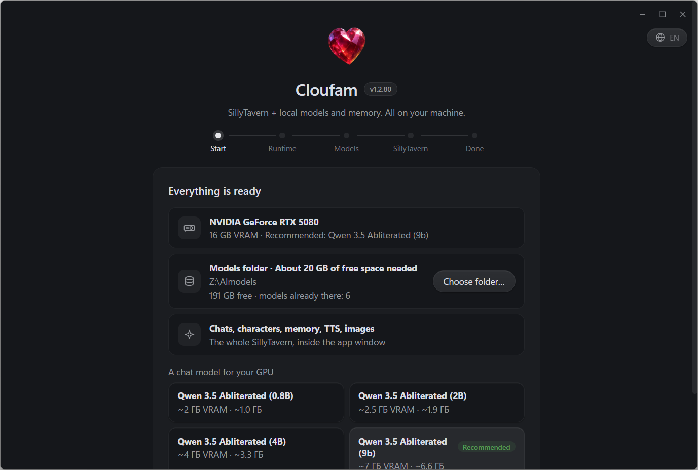

# Cloufam guide

Cloufam is a single portable `Cloufam.exe`. It installs Ollama and SillyTavern itself, picks models that fit your GPU and opens SillyTavern in its own window. Everything runs locally.

## 1. First run

1. Put `Cloufam.exe` into any folder you can write to and run it. No administrator rights are needed.
2. The wizard detects your GPU and VRAM and suggests a chat model for them. The recommended one is marked.
3. **Models folder.** The default is `Z:\AImodels`. If models already exist on disk (for example `%USERPROFILE%\.ollama\models`), the wizard shows that folder with a "Use" button, and nothing is downloaded twice.
4. Press "Start installation". The wizard downloads the portable Ollama runtime (~1.7 GB), the models you picked and SillyTavern.

## 2. Home screen

After setup you land on the home screen: service status, the active model and the ▶ button.

- **"Ready to launch"** means Ollama and SillyTavern are up. While they start, progress is shown there.
- **Model** is the drop-down next to the status: the model the chat answers with.
- **▶ "Open SillyTavern"** opens the chat in the same window.
- **⋯** has the models folder, the SillyTavern folder, the settings window and a wizard rerun.

Sidebar:

| Section | What is inside |
|---|---|
| Models → Chat & dialogue, Vector memory, Vision, Images, Another model | pick and download a model for each role |
| Tuning → Recommended settings | context and parameters tuned for your hardware |
| Tuning → Inference parameters | temperature, top-p, reply length |
| Tuning → Characters & tags | auto-tags and personality traits |
| Training → Text training / Image training | LoRA from your own datasets |
| Models folder, SillyTavern | open the folders in Explorer |
| About | author, license, links |
| Language | Russian / English / follow the system |

## 3. Chatting in SillyTavern

▶ opens SillyTavern in the app window: no system frame, Cloufam's own window buttons. The "Cloufam" theme is liquid glass over a wallpaper. The default wallpaper is Cloufam's own anime room.

- **Characters** is the card icon on the right of the top bar: PNG card import, folders and search.
- **Background** is the picture icon in the top bar. Once you pick your own, Cloufam no longer changes it.
- **The model connection** is preconfigured: SillyTavern talks to Cloufam's local gateway, which forwards to Ollama. If you reset the API settings in ST, Cloufam restores the connection on the next start.
- **Your own characters** are `*.png` cards (plus an optional `tags.json`) in a `characters` folder next to `Cloufam.exe`. They are seeded into SillyTavern on every start. Existing cards are never overwritten.

## 4. Window, tray, updates

- **The window** remembers its size, position and maximized state between runs.
- **The close button** hides the window to the tray, and the services keep running. Double-clicking the tray icon brings the window back. Starting the exe a second time also brings the open window back.
- **Tray menu:** "Open Cloufam", "Model settings", "Models folder", "Guide", "Quit". "Guide" is the detailed in-app reference: where every feature lives and how to use it, including the SillyTavern menus.
- **Updates** are signed self-updates: the app downloads the new version, checks its signature and restarts. SillyTavern is upgraded in place, and characters and chats are kept.

## 5. Where the data lives

The app is portable: everything lives next to `Cloufam.exe`.

| Folder | Contents |
|---|---|
| `data\` | Cloufam settings (`settings.json`), window state, boot log |
| `runtime\ollama\` | portable Ollama |
| `sillytavern\data\default-user\` | SillyTavern characters, chats, lorebooks and backgrounds |
| `characters\` | your card pack for auto-import (optional) |
| models folder | model weights: `Z:\AImodels` by default, or the one picked in the wizard |

To move the app, copy the whole folder.

## 6. Troubleshooting

- **"Error" status on the home screen:** press ↻ (retry) next to the status. Details are in `data\boot.log`.
- **The model is slow or falls back to the CPU:** lower the context in "Recommended settings" or pick a smaller model.
- **Images are not generated:** image generation through ComfyUI works on NVIDIA GPUs only. On AMD, Intel and CPU-only machines the images tab says generation is unavailable.

